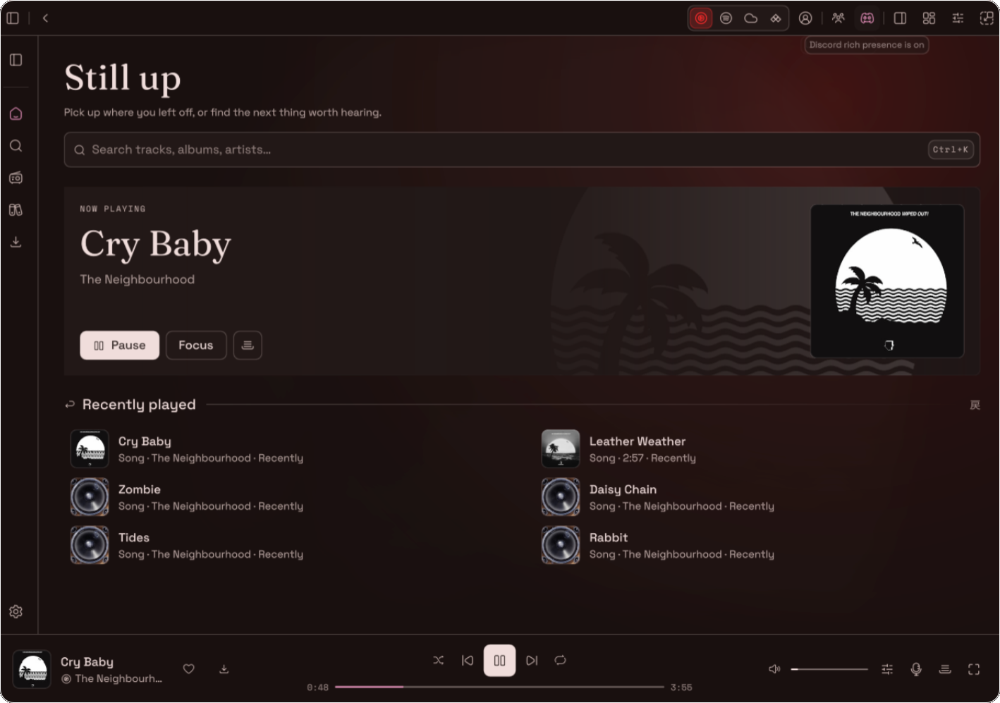

<div align="center">
  

  <h1>RyotunesNix</h1>

  <p><strong>The native music app for Ryoku on NixOS.</strong></p>

  </p>

  


</div>

<br>

## Made specifically for NixOS

**RyotunesNix** brings [Ryotunes](https://github.com/Ryoku-dev/ryotunes) to [Ryoku on NixOS](https://github.com/Ryoku-dev/Ryoku-on-NixOS), completely building it from the ground up to natively support NixOS first. The entire application is written in rust and QML, the old version using Tauri + WebKitGTK is still avaliable as a fallback.

## Features

<table>
  <tr>
    <td valign="top">
      <strong>Multiple Providers</strong><br>
      Ryotunes includes streaming from Spotify, YT Music, Souncloud, Tidal and music from your local library, Ryotunes also includes a dedicated installer to install all your music and keep it local.
    </td>
    <td valign="top">
      <strong>Audiophile Mode</strong><br>
      Audiophile Mode adds a 20 band parametric EQ with frequency and gain sliders, it also includes a bar and curve cava spectrum, oscilloscope and a vectorscope and a dedicated focus mode with live lyrics.
    </td> 
  </tr>
  <tr>
    <td valign="top">
      <strong>Customisability</strong><br>
      Ryotunes comes bundles with 12 default themes and a Matugen theme, the Ryostore contains 20+ more additional themes made by the community and fully compatable with Ryotunes.
    </td>
    <td valign="top">
      <strong>Discord RPC</strong><br>
      Ryotunes comes with a fully customisible and native Discord Rich Presence automatically detecting Discord/ Vesktop and adding it to your ptofile automatically when listening.
    </td>
  </tr>
</table>

<details>
  <summary><strong>More interface previews</strong></summary>
  <br>
  
  
</details>

## Getting started

### With Ryoku on NixOS

RyotunesNix is integrated into the [Ryoku on NixOS](https://github.com/Ryoku-dev/Ryoku-on-NixOS) package bundle. On a supported Ryoku installation, launch it with:

```bash
ryotunes
```

Ryoku manages the installed player and its socket-activated daemon as part of the desktop configuration.

### Using the flake directly

To try the native application from this repository:

```bash
nix run github:Ryoku-dev/RyotunesNix
```

Or build the package:

```bash
nix build github:Ryoku-dev/RyotunesNix#ryotunes
```

The flake currently targets **x86_64-linux**. A standalone flake invocation supplies the player but **does not automatically install the Ryoku NixOS user services**. The native client needs a running `ryotunesd` daemon. For the fully managed desktop experience, use the Ryoku on NixOS integration.

## Spotify Soloist

Spotify playback through Soloist uses an **optional external backend**. RyotunesNix includes the local bridge, but it does not bundle the Soloist executable or any account credentials.

After obtaining your own permitted Soloist executable and API key, run the one-time setup:

```bash
nix run 'github:Ryoku-dev/RyotunesNix#setup-soloist' -- /absolute/path/to/soloist
```

The setup creates an opt-in systemd user service that starts Soloist on login. Your key stays on your machine, outside the Nix store. A running Soloist backend and `ryotunesd` are both required for this playback path.

See **[Spotify Soloist setup and troubleshooting](docs/spotify-soloist.md)** for the full instructions and security notes.

## Inside the project

| Path | Purpose |
| --- | --- |
| [`client/`](client/) | Native Quickshell UI and playback surfaces |
| [`crates/`](crates/) | Rust playback core, daemon, CLI and protocols |
| [`nix/`](nix/) | NixOS package and native launcher wrapper |
| [`skins/`](skins/) | Bundled visual skins and skin schema |
| [`docs/`](docs/) | Design, architecture and troubleshooting references |

**Want to customise it?** Start with the [skin guide](docs/SKINS.md) and [design language](docs/DESIGN.md). For source changes, read [CONTRIBUTING.md](CONTRIBUTING.md).

## Credits and licence

RyotunesNix is maintained as the NixOS-focused edition of [Ryotunes](https://github.com/Ryoku-dev/ryotunes), a modified work derived from [LiMusic](https://github.com/SimoHypers/limusic).

Licensed under **[GPL-3.0-or-later](LICENSE)**. See [UPSTREAM.md](UPSTREAM.md) for attribution and project history.

<div align="center">
  <br>
  <sub>緑 · Ryoku</sub>
  <p><strong>Keep the music. Lose the clutter.</strong></p>
</div>
